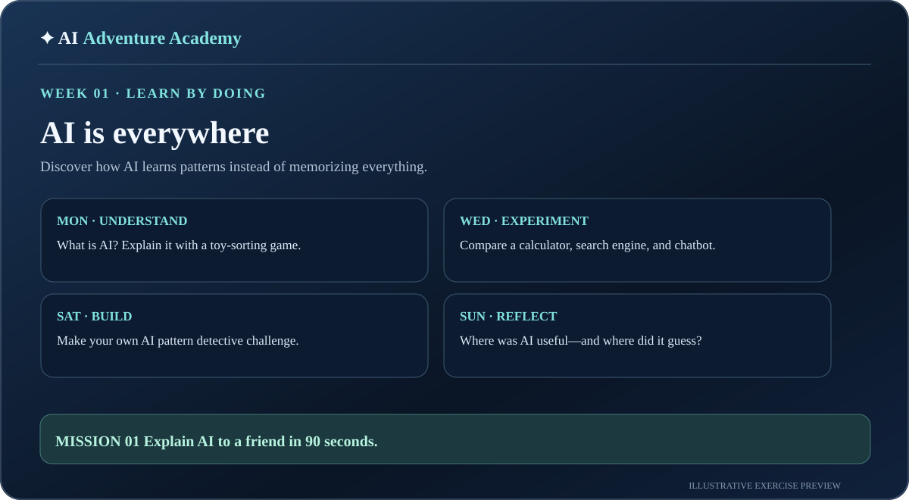
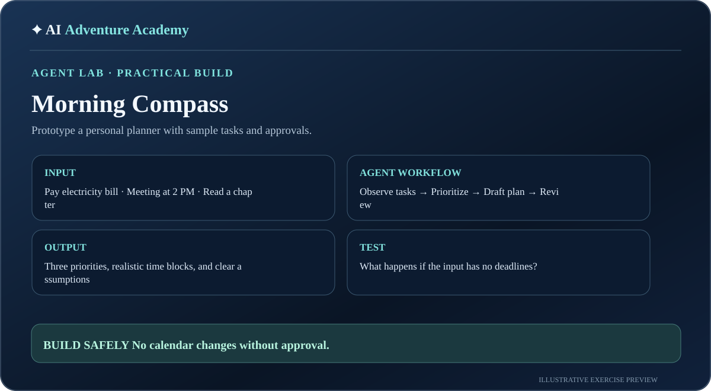
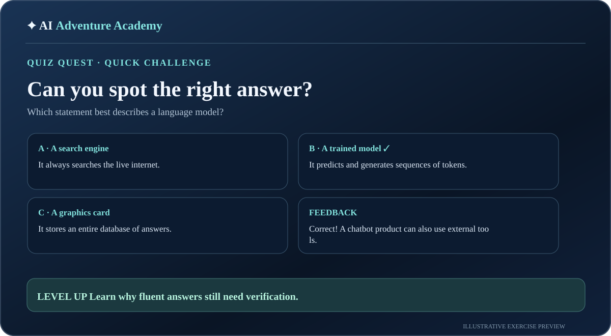
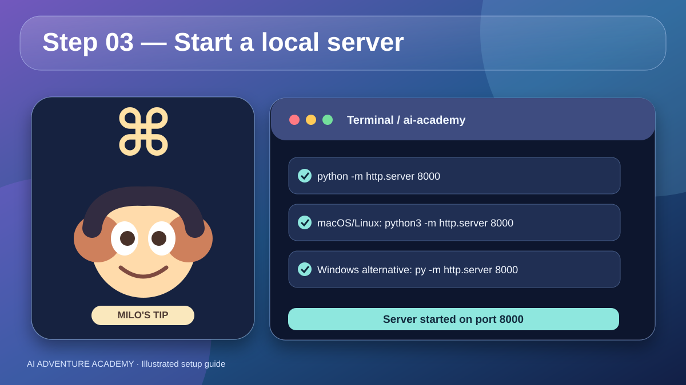

# ✦ AI Adventure Academy

**A free, hands-on AI learning adventure for curious children, everyday beginners, practical creators and advanced builders.**

🌐 **[Open AI Adventure Academy](https://jsankr.github.io/ai-academy/)** · 📓 **[Practical Workbook](https://jsankr.github.io/ai-academy/workbook.html)**

Learn AI through playful experiments, helpful explanations, guided exercises, nine agent prototypes, and a personal progress cockpit. Meet **Milo**, our cheerful 3D chimp learning companion.

> No programming experience required for beginner lessons. The app itself is a static website. It does not need a paid AI subscription, backend, account or database to run its built-in lessons.

## ✨ What you'll find

| Feature | Experience |
|---|---|
| Four learning paths | Young Explorers (with adult guidance), Everyday Beginners, Practical Builders, Expert Lab |
| 12-week curriculum | AI basics → creative AI → productivity → agents → vibe coding → publishing |
| Learning Cockpit | Course completion, progress percentage, quiz results, learner rank, next lesson |
| Milo, the chimp guide | Playful animated character with built-in lesson explanations and next-step guidance |
| AI glossary | Searchable explanations of tokens, models, weights, GPUs, LLMs and more |
| Nine agent labs | Planner, inbox sorter, budget analyzer, research helper, meeting assistant, creator, buyer comparison, quiz tutor and maintenance helper |
| Practical workbook | Hands-on projects, examples, evaluation checks and safe development practices |
| Local and offline-ready | Run from a local HTTP server; supported browsers may cache the app shell after first load |

**Milo is a course-aware offline guide, not a live ChatGPT or Claude model.** His answers are limited to the built-in lesson topics. He doesn't independently browse the internet or access private accounts. The mascot is a 3D-rendered image animated in the interface, not a rotatable 3D geometry model.

## 🐵 Meet Milo

Milo is designed to make learning less intimidating. Click his character to open the help panel, ask about AI concepts, request your next lesson or review your progress. You can pause his movement, close the dialog with **Escape**, or turn motion off through your device's reduced-motion preference.



## 🎓 Choose your learning path

| Path | Suitable for | How you learn | Final challenge |
|---|---|---|---|
| 🪁 Young Explorers | Roughly ages 8–12, supervised | Pattern detective games, stories, drawing, simple flowcharts | Make an AI-inspired comic or storybook |
| 🌱 Everyday Beginners | Teens and adults new to AI | Plain-language analogies, everyday prompts, creative content | Produce a personal AI-assisted organizer |
| 🛠️ Practical Builders | Learners ready to make things | No-code automation, nine agent prototypes, website creation | Publish a useful website |
| 🚀 Expert Lab | Learners with technical experience | APIs, Python, RAG, testing, safe agent design | Build an evaluated, controlled AI workflow |

Age labels are suggestions rather than entry requirements. Children should use only age-eligible third-party services and have adult supervision. Avoid entering children's identifying or private information into external AI services.

## 📅 Your 12-week AI adventure

**Self-guided schedule:** Monday 7:30–8:30 PM, Wednesday 7:30–9:00 PM, Saturday 10 AM–12 PM, Sunday 10–10:30 AM, in India Standard Time (IST). The original cohort starts **30 November 2026**, but you can start any time. The 5-hour weekly commitment is a guideline; young learners may prefer shorter sessions.

| Week | Topic | Build / experiment |
|---|---|---|
| 1 | What AI really is | Recognize AI versus ordinary software |
| 2 | LLMs, GPUs, weights, parameters and tokens | Trace how a chatbot generates an answer |
| 3 | ChatGPT, Claude and useful prompts | Create a reusable prompt toolkit |
| 4 | Image creation and editing | Design and compare original posters |
| 5 | AI videos, voice and sound | Build a narrated short explainer |
| 6 | Presentations and personal productivity | Create useful slides and everyday routines |
| 7 | Finance, trading, manufacturing, design and literature | Solve five industry mini-challenges |
| 8 | What agents are and how they work | Design a safe agent workflow |
| 9 | Agent projects 1–3 | Morning planner, inbox draft organizer, sample-budget helper |
| 10 | Agent projects 4–6 | Research scout, meeting notes and content creator |
| 11 | Agent projects 7–9 | Shopping analyst, quiz coach and maintenance assistant |
| 12 | Vibe coding, testing, security and publishing | Create, review and share a responsive website |

## 🎮 Peek inside the exercises

| Weekly mission | Agent laboratory |
|---|---|
|  |  |



The exercise illustrations demonstrate lesson content; they are not literal screenshots of a live browser.

---

## 💻 Run AI Adventure Academy on your own computer

You can use the **public website** without downloading anything, or run a **local copy** on Windows, macOS or Linux. Running locally is useful for offline study, customizing the curriculum and testing changes.

### Before you begin

You need a modern browser (Firefox, Chrome, Edge or Safari), approximately 50 MB of disk space for the complete image-rich project, and either **Python 3** or **Node.js** for the optional local HTTP server. Git is optional. For installing a desktop-style shortcut, browser support varies.

### Step 1 — Download the course


1. Open [github.com/jsankr/ai-academy](https://github.com/jsankr/ai-academy).
2. Click the repository's **Code** button.
3. Select **Download ZIP**.
4. Save the ZIP to a location you can find, such as Downloads.

If you already use Git, you can instead run:

```bash
git clone https://github.com/jsankr/ai-academy.git
```

### Step 2 — Extract the files


On Windows, right-click the ZIP and choose **Extract All**. On macOS, double-click the ZIP to extract it. On Linux, extract it using your file manager or an unzip utility.

Open the extracted `ai-academy-main` folder (or the `ai-academy` folder when cloned). Keep the project files together:

```text
ai-academy/
├── index.html
├── workbook.html
├── course-data.json
├── manifest.webmanifest
├── sw.js
├── README.md
└── assets/
    ├── milo-3d.webp
    ├── academy-icon.svg
    └── setup-step-*.svg
```

### Step 3 — Start the application locally



A lightweight local web server is recommended so that service workers and local file references behave consistently.

**Windows:**

1. Open the project folder in File Explorer.
2. Click the address bar, type `cmd`, and press Enter.
3. Enter:

```powershell
py -m http.server 8000
```

If `py` is unavailable but Python is installed, try `python -m http.server 8000`.

**macOS:**

1. Open Terminal.
2. Change directory to your extracted project folder (you can type `cd ` and drag the folder into Terminal).
3. Run:

```bash
python3 -m http.server 8000
```

**Linux:**

Open Terminal in the project directory and run:

```bash
python3 -m http.server 8000
```

**Alternative for all systems with Node.js installed:**

```bash
npx serve .
```

The Node.js alternative may select a different port. Use the URL shown in the terminal. `npx` might download a dependency the first time and requires internet access for that installation.

The server keeps running while its terminal is open. Press **Ctrl+C** in the terminal to stop it.

### Step 4 — Open the course


Open a browser and visit:

**http://localhost:8000/**

You should see the academy homepage, learning paths, progress dashboard and Milo. Open the workbook, choose a lesson, try the glossary, then answer a quiz question to check the experience.

If you chose another server port, update the URL accordingly—for example, `http://localhost:8001/`.

### Step 5 — Optional: add a desktop shortcut or install as an app


**Shortcut:** In Chrome or Edge, use the browser's application/shortcut menu when available, or create an ordinary desktop shortcut to your local URL. A shortcut alone does not install a native application.

**Installable web app:** On browsers that support installation for this site, use the **Install app** action in the address bar or menu. The project includes a web manifest and service worker; availability of the install action still depends on the browser and platform.

**Important:** A shortcut to `localhost:8000` requires you to start the local server before use. A hosted installation at [jsankr.github.io/ai-academy](https://jsankr.github.io/ai-academy/) doesn't require your own local server, but the first visit and some external resources require internet access. This is a **PWA/desktop-style web experience**, not an Electron installer or a downloadable Windows EXE/macOS DMG.

## 🧭 First lesson — a five-minute tour

1. Choose a learning level.
2. Open the first incomplete week.
3. Read Monday's introduction, try Wednesday's experiment and build Saturday's small project.
4. Copy a tutor prompt when you want a deeper explanation in your chosen AI assistant.
5. Mark the week complete only after trying the exercise.
6. Open Milo and ask **“What should I learn next?”**.
7. Look at the Learning Cockpit for your completion percentage, quiz result and next mission.

Your completion record is saved using browser `localStorage`; it is not synced between computers or browser profiles. Use **Export saved progress** to make a JSON backup.

## 🏗️ How this training was designed

1. Define outcomes that matter in daily life: understand AI, create useful work, improve decisions, build safe agents and share applications.
2. Organize concepts from familiar examples toward technical mechanics.
3. Differentiate four learning paths without requiring everyone to have the same background.
4. Make each weekly activity experiential: concept → experiment → hands-on project → reflection.
5. Add sample datasets, reusable prompts, verification tasks and carefully bounded automation exercises.
6. Include measurable progress, interactive quizzes, a playful mascot and a self-guided timetable.
7. Build the frontend in semantic HTML, CSS and JavaScript without a mandatory external runtime.
8. Document privacy boundaries, age suitability, security considerations and limitations.
9. Validate syntax, links and referenced local assets, then review changes before release.

## 🛠️ Project architecture

| File / directory | Purpose |
|---|---|
| `index.html` | Main interactive learning application, lessons, progress dashboard, quizzes and Milo |
| `workbook.html` | Practical workbook and agent-building exercises |
| `course-data.json` | Readable curriculum reference; not necessarily the sole data source used by the current page |
| `manifest.webmanifest` | Web-app name, icon and standalone display metadata |
| `sw.js` | Service-worker caching of supported local resources |
| `assets/` | Mascot artwork, course graphics, icons and installation diagrams |
| `README.md` | Course overview, learner guidance and local running instructions |

### Local development tips

- Update the page content and any corresponding data reference when editing the curriculum.
- Check browser developer-console errors if an interaction stops working.
- Keep `index.html` and `assets/` in their relative positions.
- Do not hard-code paid service API tokens or private personal data in this static frontend.
- For a genuinely connected AI tutor, build a backend that safely holds API credentials and enforces access control, usage limits and age-appropriate safeguards.

## 🧪 Functional checks you can perform

- Open the homepage and `workbook.html` without a 404.
- Test the learning paths and all 12 weekly cards.
- Confirm glossary search filters terms.
- Complete and reset the quiz.
- Mark and unmark a week; verify the cockpit responds.
- Refresh the browser and confirm progress remains on the same device.
- Open Milo, request a concept explanation and pause animation.
- Check the layout at phone and desktop widths, and navigate using keyboard Tab.
- Check image paths, any PWA installation behavior and offline loading after initial caching.
- Verify generated facts and external learning links independently.

Static code checks do not guarantee full browser functionality, accessibility compliance or security certification.

## 🔐 Privacy, safety and limitations

The built-in course needs no account and uses no mandatory analytics service. Progress is browser-local. Milo's question-answering is **prewritten/topic-matched** rather than unrestricted conversational AI.

Never put passwords, API keys, access tokens or private health/financial records in a public repository. Agent prompts and workflows are learning prototypes and do not send messages, purchase items or make trades on their own. Sensitive external actions require explicit human approval and appropriately protected tools.

Third-party AI tools may require paid accounts and have separate minimum-age rules. Financial and trading activities are educational rather than promises of returns.

## 🧰 Troubleshooting

| Problem | Suggested fix |
|---|---|
| Python command not found | Install Python 3, or try `py` on Windows / `python3` on macOS and Linux |
| Port 8000 occupied | Use `python -m http.server 8001` and open `http://localhost:8001/` |
| Pictures missing | Preserve the full `assets/` folder and check case-sensitive filenames |
| Older design still displayed | Refresh, clear site cache if necessary, and check the service worker |
| Local shortcut doesn't open | Start the local server first; verify the port |
| Milo moves too often | Use his Pause movement control or reduced-motion accessibility settings |
| Progress seems lost | Check the same browser profile and site address; progress isn't cloud-synced |

## 📚 Primary learning references

- [OpenAI Academy — AI Fundamentals](https://openai.com/academy/ai-fundamentals/)
- [OpenAI — Understanding tokens](https://help.openai.com/en/articles/4936856-understanding-and-counting-tokens)
- [Anthropic — Building Effective Agents](https://www.anthropic.com/research/building-effective-agents)
- [n8n — AI workflow tutorial](https://docs.n8n.io/advanced-ai/intro-tutorial/)
- [OpenAI Agents SDK](https://openai.github.io/openai-agents-python/quickstart/)
- [OWASP GenAI Security Project](https://genai.owasp.org/)
- [MDN — Progressive web apps](https://developer.mozilla.org/en-US/docs/Web/Progressive_web_apps)

---

**AI Adventure Academy is an independent educational project.** Third-party brand names, service names and trademarks belong to their respective owners. No certification or official affiliation is implied.
