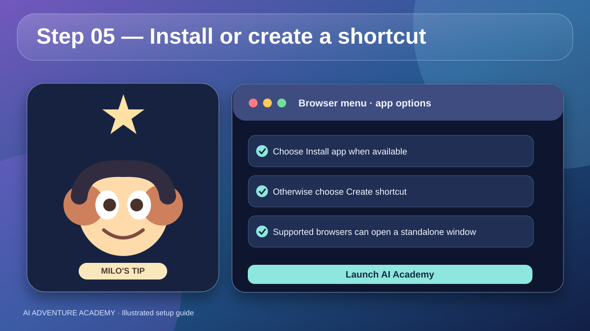

# ✦ AI Adventure Academy

**A free, interactive, glassmorphism-style AI learning website with a 3D chimp guide named Milo.**

AI Adventure Academy is a static web application designed for **kids, beginners, builders and advanced learners**. It teaches AI fundamentals, creative tools, productivity, agents, vibe coding and publishing — through a **12-week hands-on journey**.

## What is new in this version?

- **New 3D-rendered Milo mascot integrated into the application**
- **Jumping Milo guide** that moves around the site and opens an interactive help panel
- **Glassy Figma-style UI/UX refresh** with richer cards, gradients and hover depth
- **Learning Cockpit dashboard** for progress, quiz scores and next-step guidance
- **Illustrated setup guide** with five images explaining how to run it locally and optionally install it like a standalone app

## Who can learn?

| Path | Learner | Experience | Sample capstone |
|---|---|---|---|
| 🪁 Young Explorers | Ages 8–12, with adult supervision | Pattern games, stories, drawings, paper flowcharts | AI comic or storybook |
| 🌱 Everyday Beginners | Teens 13+ and nontechnical adults | ChatGPT/Claude, prompts, media tools, productivity | Illustrated life organizer |
| 🛠️ Practical Builders | Intermediate | n8n/Make, 9 safe agent prototypes, vibe coding | Personal dashboard |
| 🚀 Expert Lab | Advanced learners | Python, APIs, RAG, security, evaluation | Controlled agent app |

## Project structure

- `index.html` — main academy experience
- `workbook.html` — deeper practical labs and agent exercises
- `course-data.json` — content reference
- `assets/milo-3d.webp` — integrated 3D Milo mascot
- `assets/setup-step-*.png` — illustrated setup instructions
- `manifest.webmanifest`, `sw.js` — installable-web-app metadata and offline caching
- `README.md` — this guide

## How the training was created

1. Define the learner outcomes: AI basics, tools, productivity, agents and publishing.
2. Split the material into a 12-week plan with a fixed rhythm: learn, experiment, build and review.
3. Design four levels so the same concepts work for children, everyday adults, practical builders and advanced users.
4. Turn each concept into an experiment, a prompt, a checkpoint and a small capstone.
5. Build a static web app so the course can run locally without logins or subscriptions.
6. Add a course-aware helper (Milo) to improve guidance and motivation.
7. Add a visual dashboard so progress is visible and fun.
8. Validate HTML, JavaScript, file links and local serving.

## Run it on your machine — step by step

AI Adventure Academy is a **static web application**. You do not need a database or heavy installation. It can run on **Windows, macOS or Linux**.

### Step 1 — Download the project


- Open the **ai-academy** repository.
- Click **Download ZIP**.
- Alternatively, clone it with Git.

**Optional Git command**

```bash
git clone https://github.com/jsankr/ai-academy.git
```

### Step 2 — Extract and open the folder


- Extract the ZIP file.
- Open the project folder.
- You should see files like `index.html`, `workbook.html`, `README.md`, `course-data.json` and the `assets` folder.

### Step 3 — Run it locally


Open **Terminal**, **Command Prompt**, or **PowerShell** inside the project folder, then run **one** of the following:

**Option A — Python**

```bash
python -m http.server 8000
```

**Option B — Node.js / npx**

```bash
npx serve .
```

### Step 4 — Open it in your browser


Open your browser and visit:

```text
http://localhost:8000
```

The homepage should load with:
- the 3D Milo hero section
- the Learning Cockpit dashboard
- the floating Milo guide
- the 12-week roadmap
- the workbook link and setup section

### Step 5 — Optional: install it like a standalone application



After opening the app in your browser, you can launch it like a standalone desktop-style app.

- In supported **Chrome / Edge** versions, try **Install app**. When that option is unavailable, choose **Create shortcut** instead.
- In some browsers, this option appears in the **⋮ menu**.
- Where browser installation is supported, the app opens in its own standalone window. A shortcut may instead open a normal browser window.

## Quick local usage notes

- Progress is saved in your browser using `localStorage`.
- No account is required.
- No analytics or trackers are used.
- The built-in Milo guide is local and course-aware; it does not require a live AI backend.

## Testing completed locally

The following local checks were completed for this package:

- HTML file structure updated successfully
- JavaScript syntax parsed successfully
- Required image assets copied into `assets/`
- Main pages available for local serving: `index.html` and `workbook.html`
- README image references updated to local asset paths

## Important limitations

- Milo's chat guidance is **built-in scripted course guidance**, not a full live ChatGPT/Claude integration.
- Cross-browser visual QA on physical devices should still be done after you publish.

## Privacy and safety

- Do not place API keys or secrets into a public static site.
- The agent examples are educational prototypes, not autonomous production agents.
- Financial and trading content is for learning only, not investment advice.
- Children should use external AI services only with appropriate adult supervision and age-appropriate tools.

## Learning references

- [OpenAI Academy](https://openai.com/academy/ai-fundamentals/)
- [OpenAI: understanding tokens](https://help.openai.com/en/articles/4936856-understanding-and-counting-tokens)
- [Anthropic: building effective agents](https://www.anthropic.com/research/building-effective-agents)
- [n8n AI workflow tutorial](https://docs.n8n.io/advanced-ai/intro-tutorial/)
- [GitHub Pages quickstart](https://docs.github.com/en/pages/quickstart)

## What Milo can and cannot do

Milo is your **3D-rendered chimp mentor**. He moves between visible sections, opens a question-and-answer panel, explains built-in AI concepts and reacts to your progress. The guide is currently **offline and rule-based**: it is *not* connected to ChatGPT or Claude, cannot browse the web or independently run tasks, and does not transmit your questions to a server. Choose **Pause movement** below Milo if you prefer less motion. System reduced-motion preferences are also honored.

## If something doesn't work

- On macOS/Linux, use `python3 -m http.server 8000` if `python` is not found.
- On Windows, try `py -m http.server 8000` if Python is installed but `python` does not work.
- If port 8000 is in use, run `python -m http.server 8001` and open `http://localhost:8001`.
- Keep the `assets` directory beside `index.html` so images appear correctly.
- If the app looks outdated after an update, refresh it or reopen the installed app.

**The illustrated setup panels are explanatory diagrams, not literal screenshots of GitHub or browser menus.** Available menu labels differ by browser and operating system.
