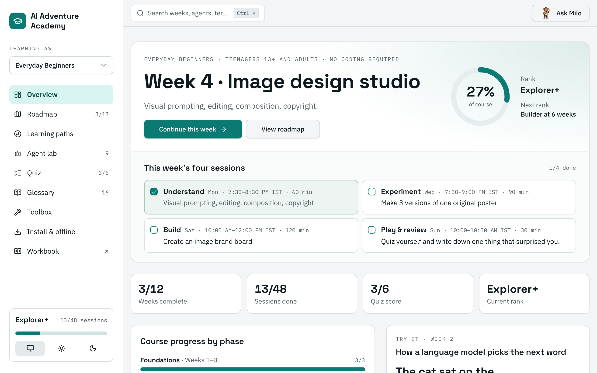
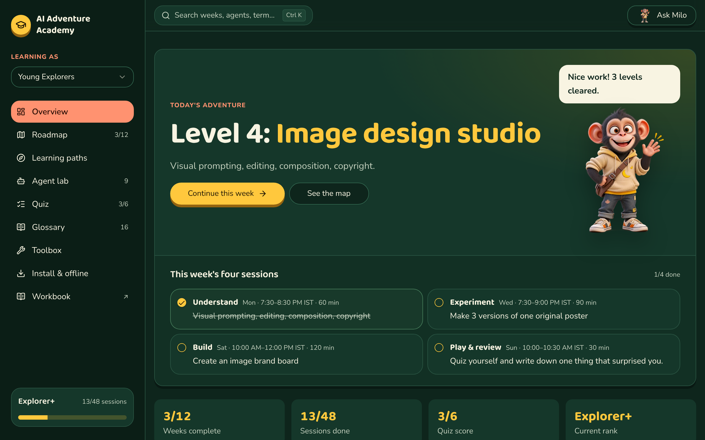
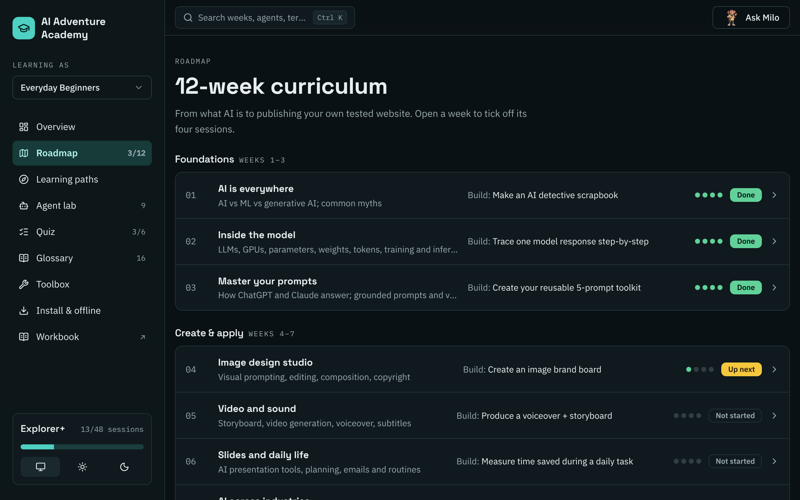
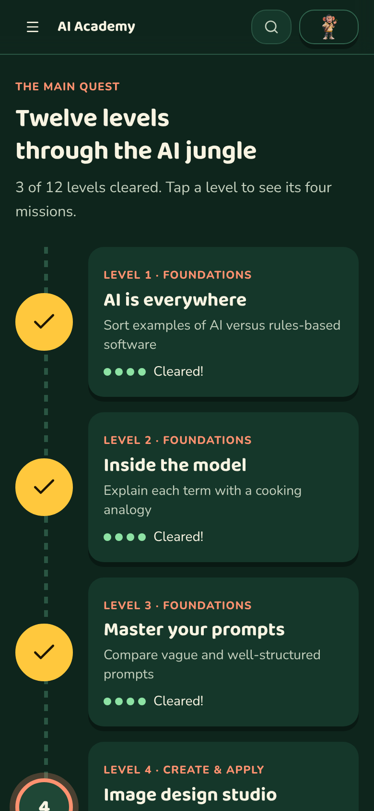
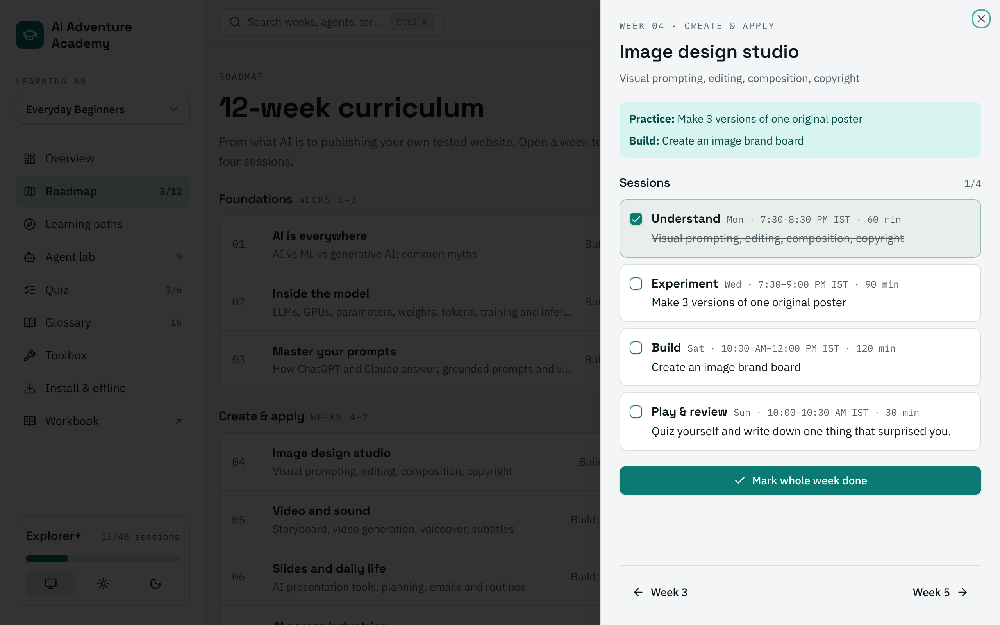
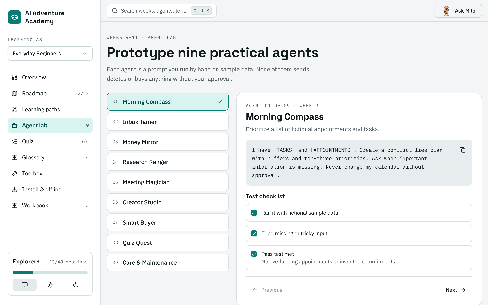
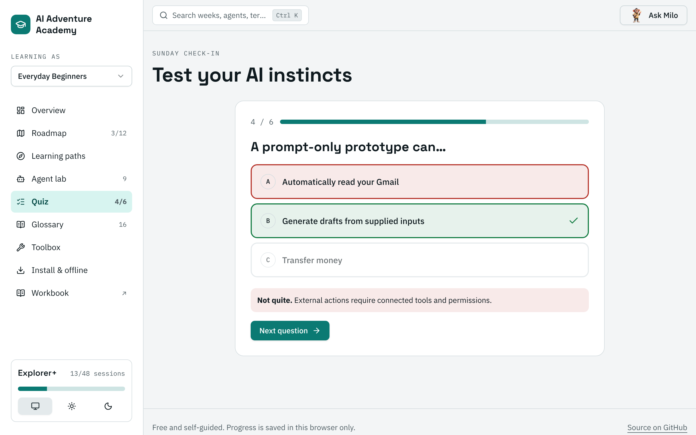
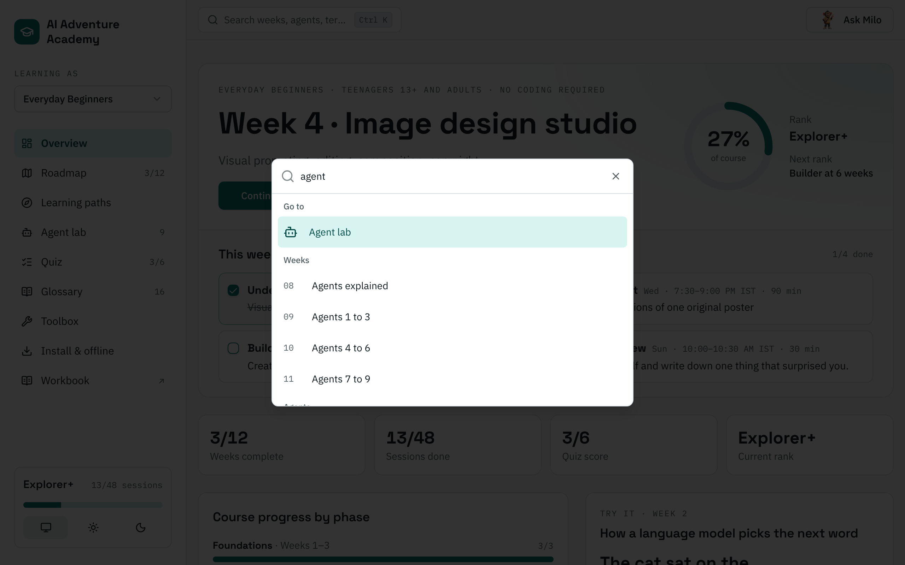
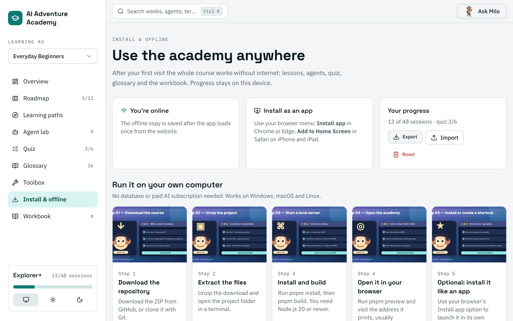

# AI Adventure Academy

**A free, hands-on 12-week AI course for curious kids, everyday beginners, practical builders and experts. Works offline and installs like an app.**

**[Open the academy](https://jsankr.github.io/ai-academy/)** · **[Practical workbook](https://jsankr.github.io/ai-academy/workbook.html)**



Learn how AI works by building with it: from tokens and model weights to nine agent prototypes and your own published website. Pick a learning path, tick off four short sessions a week, and let **Milo**, the course's chimp guide, point you to what's next.

No account, no paid AI subscription, no backend. Progress stays in your browser.

> Screenshots in this README show sample progress (three weeks done) so the screens aren't empty.

---

## What's inside

| Area | What you can do |
|---|---|
| **Overview** | See this week's lesson and its four sessions, your progress ring, rank and the next rank, progress per course phase, and a "pick the next word" demo of how a language model writes |
| **Roadmap** | All 12 weeks grouped into four phases (Foundations, Create & apply, Agents, Ship it). Open any week to tick off its sessions |
| **Learning paths** | Compare the four paths side by side and switch any time. Your progress is kept when you switch |
| **Agent lab** | Nine agent prompts to copy and run on sample data, each with a three-step test checklist |
| **Quiz** | One question at a time with an explanation after each answer, then a results review |
| **Glossary** | 16 AI terms in plain language, with live search |
| **Toolbox** | Links to 13 AI tools used in the course |
| **Install & offline** | Offline status, an Install button where the browser supports it, and export, import or reset of your progress |
| **Ask Milo** | A help panel that answers questions about course topics and your progress |
| **Search (Ctrl K / ⌘ K)** | Jump to any section, week, agent or glossary term from anywhere |

### Two looks, chosen by your path

Teens and adults get the **Studio** look: calm, focused, with light and dark themes. Choose **Young Explorers** and the whole app changes to the **Quest** look: a jungle-green adventure map where weeks become levels and Milo stands at the level you're on.

| Studio (teens and adults) | Quest (Young Explorers) |
|---|---|
|  |  |
|  |  |

### Week detail and sessions

Every week has four sessions that match the timetable. A week counts as done once all four are ticked, or you can mark the whole week done in one go.



| Agent lab | Quiz |
|---|---|
|  |  |

| Ask Milo | Search everything |
|---|---|
|  |  |



---

## Choose your learning path

| Path | Suitable for | How you learn | Final challenge |
|---|---|---|---|
| **Young Explorers** | Roughly ages 8–12, with an adult | Pattern games, stories, drawing, paper flowcharts | A four-page comic explaining how AI helps and makes mistakes |
| **Everyday Beginners** | Teens 13+ and adults, no coding | Plain-language explanations, everyday prompts, creative media | An AI-assisted personal life organizer |
| **Practical Builders** | Learners ready to make things | No-code automation, the nine agent prototypes, website building | Publish a useful website |
| **Expert Lab** | Learners with technical experience | APIs, Python, RAG, testing, safe agent design | An evaluated, controlled AI workflow |

Age labels are suggestions, not entry rules. Children should only use age-eligible third-party services, with adult supervision, and should never enter identifying or private information into external AI tools.

## The 12-week course

| Week | Topic | Build |
|---|---|---|
| 1 | AI is everywhere | An AI detective scrapbook |
| 2 | Inside the model: LLMs, GPUs, parameters, weights, tokens | Trace one model response step by step |
| 3 | Master your prompts | A reusable five-prompt toolkit |
| 4 | Image design studio | An image brand board |
| 5 | Video and sound | A voiceover and storyboard |
| 6 | Slides and daily life | Measure time saved on a daily task |
| 7 | AI across industries | A five-industry mini showcase |
| 8 | Agents explained | A no-code agent prototype |
| 9 | Agents 1–3: planner, inbox sorter, budget helper | Three manual-trigger prototypes |
| 10 | Agents 4–6: research, meetings, content | Three more prototypes |
| 11 | Agents 7–9: shopping, study coach, maintenance | Test the final three agent prompts |
| 12 | Vibe-code and publish | Publish your tested final website |

### Weekly rhythm (India Standard Time)

| Day | Session | Time | What you do |
|---|---|---|---|
| Monday | Understand | 7:30–8:30 PM | Learn one concept |
| Wednesday | Experiment | 7:30–9:00 PM | Try a tool |
| Saturday | Build | 10:00 AM–12:00 PM | Make something useful |
| Sunday | Play & review | 10:00–10:30 AM | Quiz and reflect |

About five hours a week. The first cohort starts **Monday 30 November 2026**, but lessons are self-guided, so you can start any time. Younger learners may prefer shorter sessions.

### Ranks

Ranks follow completed weeks: **Explorer** (0–2), **Explorer+** (3–5), **Builder** (6–8), **Architect** (9–11), **Trailblazer** (all 12).

---

## Use it offline and install it

1. Open [jsankr.github.io/ai-academy](https://jsankr.github.io/ai-academy/) once while online. The app saves an offline copy in the background.
2. From then on, every section, Milo, and the workbook open without internet. An **Offline** badge appears in the top bar while you're disconnected.
3. To install it as an app:
   - **Chrome or Edge (Windows, macOS, Linux, Android):** use **Install AI Academy** on the *Install & offline* screen, or the install icon in the address bar.
   - **Safari on iPhone or iPad:** tap Share, then **Add to Home Screen**.

When a new version is published, the app shows **"A new version of the academy is ready"** with a **Reload** button. Nothing changes until you choose to reload.

### Back up or move your progress

Progress is stored in this browser's `localStorage` only. It isn't synced between devices or browser profiles.

- **Export** downloads a small JSON file with your ticked sessions, quiz answers, agent checks, path and theme.
- **Import** restores it on another device or browser. Files that aren't academy exports are rejected.
- **Reset** clears everything on this device, after you confirm.

All three are on the **Install & offline** screen.

---

## Run it on your own computer

The easiest option is the hosted site plus **Install app**, which already works offline. Run it locally if you want to change the course or test edits.

**You need:** [Node.js 20 or newer](https://nodejs.org/) and [pnpm](https://pnpm.io/installation). Git is optional.

### 1. Download the project

Click **Code → Download ZIP** on [github.com/jsankr/ai-academy](https://github.com/jsankr/ai-academy) and extract it, or clone it:

```bash
git clone https://github.com/jsankr/ai-academy.git
```

```bash
cd ai-academy
```

### 2. Install dependencies

```bash
pnpm install
```

### 3. Start the development server

```bash
pnpm dev
```

Open the address it prints, usually `http://localhost:5173/`. Changes to the source reload instantly. The offline service worker is turned off in development so it never serves stale files while you edit.

### 4. Build and preview the real site

```bash
pnpm build
```

```bash
pnpm preview
```

Open `http://localhost:4173/`. This is exactly what GitHub Pages serves, including offline support and app installation.

| Command | What it does |
|---|---|
| `pnpm dev` | Development server with instant reload |
| `pnpm build` | Type-checks, then builds the site into `dist/` |
| `pnpm preview` | Serves `dist/` locally to test the production build |
| `pnpm typecheck` | Type-checks without building |

---

## Deploying to GitHub Pages

`.github/workflows/deploy.yml` builds the site on every pull request and deploys `dist/` to GitHub Pages on every push to `main`.

**One-time setup:** in the repository go to **Settings → Pages → Build and deployment → Source** and choose **GitHub Actions**. Until this is set, the deploy job fails and the live site keeps serving the previous version.

The build uses relative paths (`base: "./"`), so it works at `/ai-academy/`, at a custom domain, or on `localhost` without changes.

---

## Project structure

```text
ai-academy/
├── index.html                 App entry point (Vite)
├── src/
│   ├── main.tsx               Starts React, loads the self-hosted fonts
│   ├── App.tsx                App shell: sidebar, top bar, search, Milo panel, update prompt
│   ├── views.tsx              Overview, Roadmap, Paths, Agent lab, Quiz, Glossary, Toolbox, Install & offline
│   ├── index.css              Design tokens for the Studio (light/dark) and Quest looks
│   ├── data/course-data.json  The whole curriculum: weeks, paths, agents, tools, terms, quiz
│   ├── lib/academy.ts         Progress state, ranks, routing and Milo's answers
│   ├── lib/pwa.ts             Service worker registration, online status, install prompt
│   ├── components/ui/         shadcn/ui components (Radix + Tailwind)
│   └── assets/                Images bundled into the app (Milo, setup illustrations)
├── sw/sw.js                   Service worker source
├── sw-plugin.ts               Build step that writes dist/sw.js with this build's file list
├── public/
│   ├── workbook.html          Practical workbook (standalone page)
│   ├── manifest.webmanifest   App name, colours and icons for installation
│   └── assets/                Icons, Milo artwork, exercise and setup illustrations
├── docs/screenshots/          Images used in this README
└── .github/workflows/         Build and deploy to GitHub Pages
```

### Editing the curriculum

All course content lives in **`src/data/course-data.json`**. Change a week, add a glossary term or edit a quiz question there, and every screen, the search and Milo pick it up. Keep the array shapes the same:

- `weeks`: `[title, topic, exercise, project]`, exactly 12 entries
- `tracks`: path objects with `modules` as `[title, what you learn, exercise]`
- `agents`: `[name, job, prompt, pass test]`
- `tools`: `[name, url, use]`
- `terms`: `{ "Term": "Definition" }`
- `quiz`: `[question, [three options], correct index, explanation]`

### How offline support works

- `pnpm build` runs `sw-plugin.ts`, which copies `sw/sw.js` to `dist/sw.js` and writes in the exact list of files from that build, plus a version hash.
- On first visit the worker caches the app, fonts, images, manifest and workbook.
- Pages load network-first, so learners get updates when online and the cached copy when not.
- Build files have content hashes in their names, so they're served cache-first.
- Each release gets a new cache, and old caches (including the previous `ai-academy-v7` cache) are deleted when the new worker takes over.
- Fonts are self-hosted, so the app looks the same offline and makes no requests to font services.

### Tech stack

React 19, TypeScript, Vite, Tailwind CSS and shadcn/ui (Radix primitives), with `cmdk` for search, `sonner` for notifications, `lucide-react` icons and Fontsource fonts. Space Grotesk, IBM Plex Sans and IBM Plex Mono for the Studio look; Baloo 2 and Nunito for the Quest look.

---

## Meet Milo

Milo is a cheerful chimp in a beige hoodie who guides learners through the course. Click **Ask Milo** in the top bar (or Milo himself on the Quest overview) to:

- ask what a course term means, such as *token*, *weight*, *RAG* or *agent*
- ask **"What's next?"** for your next lesson
- ask **"How am I doing?"** for your weeks, sessions, rank and quiz score
- ask about safety and privacy

**Milo is an offline, course-aware helper, not a live AI model.** He matches your question against the course's built-in topics and your saved progress. He doesn't browse the internet, call any AI service, or see anything outside this app.

Milo's artwork is a pre-rendered, 3D-style image. `public/assets/milo-4k.avif` is a 3072 × 4096 portrait upscaled from a smaller source, and the app uses the optimized 512 × 683 `milo-guide.webp`.

---

## Accessibility

- Works with keyboard only: visible focus, sensible tab order, Escape closes panels and search.
- Uses semantic landmarks, labelled controls and live regions for quiz feedback and Milo's replies.
- Respects **reduced motion**: Milo's bobbing animation and transitions are turned off.
- Light and dark themes follow your system setting, with a manual toggle in the sidebar.
- Layouts adapt from phones (about 360 px) to wide desktops without sideways scrolling.

## Privacy and safety

- No account, no analytics, no cookies. Progress is stored only in your browser.
- Agent prompts are learning prototypes. They're run by hand on fictional data and never send, delete, buy or trade anything on their own.
- Never put passwords, API keys or private health or financial records into a public repository or a static site.
- Third-party AI tools have their own pricing, privacy terms and minimum ages. Finance and trading exercises are educational, not investment advice.
- For a connected AI tutor, build a backend that keeps API keys secret and enforces access control, usage limits and age-appropriate safeguards.

## Troubleshooting

| Problem | Fix |
|---|---|
| `pnpm: command not found` | Install pnpm (`npm install -g pnpm`) or run `corepack enable` |
| Blank page when opening `dist/index.html` directly | Run `pnpm preview` instead. Browsers block modules and service workers on `file://` |
| Still seeing the old design | Reload once. If it persists, clear site data for the address in your browser settings |
| No Install button | Your browser doesn't offer an install prompt. Use its menu (Chrome/Edge) or Add to Home Screen (Safari) |
| Progress seems lost | Check you're on the same browser profile and address. Import your exported file if you have one |
| Deploy workflow fails | Set **Settings → Pages → Source** to **GitHub Actions** |

## Learning references

- [OpenAI Academy: AI Fundamentals](https://openai.com/academy/ai-fundamentals/)
- [OpenAI: Understanding tokens](https://help.openai.com/en/articles/4936856-understanding-and-counting-tokens)
- [Anthropic: Building Effective Agents](https://www.anthropic.com/research/building-effective-agents)
- [n8n: AI workflow tutorial](https://docs.n8n.io/advanced-ai/intro-tutorial/)
- [OpenAI Agents SDK](https://openai.github.io/openai-agents-python/quickstart/)
- [OWASP GenAI Security Project](https://genai.owasp.org/)
- [MDN: Progressive web apps](https://developer.mozilla.org/en-US/docs/Web/Progressive_web_apps)

---

**AI Adventure Academy is an independent educational project.** Third-party names and trademarks belong to their owners. No certification or official affiliation is implied. See [LICENSE](LICENSE).
